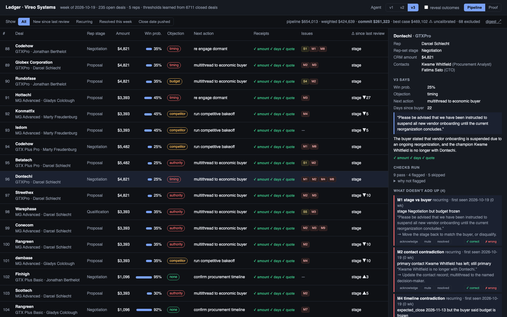
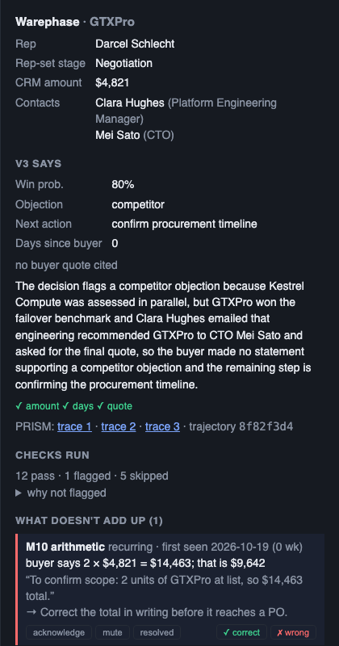
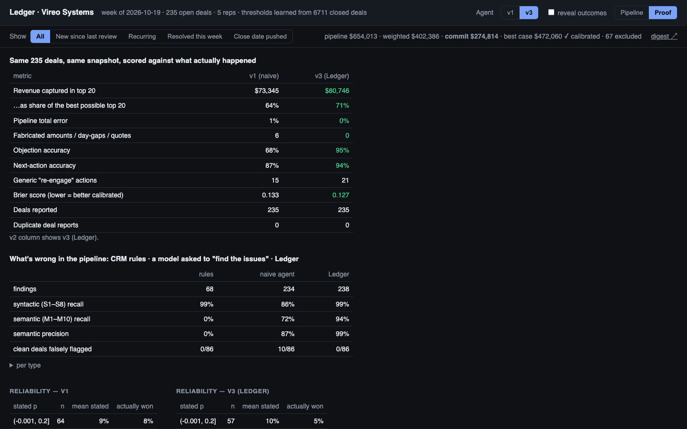

# Ledger — the revenue forecast with receipts

*AI × Fintech Hackathon "Money Talks 2" (Block Convey, Oct 17 2026) · Money Operations track*

Every month a finance team signs off a revenue forecast built from a CRM that reps fill in
optimistically: stages that contradict what the buyer actually wrote, close dates that
already passed, deals the buyer lost weeks ago but nobody closed, contacts who left the
company. The forecast inherits all of it. Ledger reads every deal's record — calls, emails,
meetings — into a claim ledger of what the *buyer* said, with verbatim quotes, compares it in
code against the CRM fields, and produces: a commit and best-case number built only from
deals that don't contradict their own record, the specific issues behind every excluded
dollar, draft CRM corrections a human approves, and a Monday digest per rep and manager.
Every number and quote is checked in code before anyone sees it, and every run is traced in
PRISM so the failures are found by the pipeline, not by the CFO.

The point of the project is not the agent. It is the proof: the same deals were run through
a naive first version, a CRM-rules baseline and the verified version, and all were scored
against what actually happened to those deals — because a forecast number is only worth
what its receipts are worth.

## Screenshots

| | |
|---|---|
|  |  |
| Pipeline tab: the ranked list with ✓ receipts and issue chips, and Dontechi · GTXPro open — p=25%, the buyer's quote, 18 checks run. | The same deal's four findings, each with the CRM value, the buyer's sentence and the action, plus draft CRM updates for a human to approve. |
|  | |
| Proof tab: v1 vs Ledger on the same 235 deals against real outcomes, and CRM rules vs a naive agent vs Ledger on the planted anomalies. | |

## The failure nobody planted

We built v1 the way most teams build their first agent: one model call per rep, every deal
in context, and the model does the ranking, the probabilities, the objection, the next step
and the arithmetic. It reads well. PRISM showed it was wrong in ways you could not see from
the output:

- **$109K of pipeline missing.** The CRM spells one product `GTXPro`; the catalogue says
  `GTX Pro`. v1 quietly dropped it from every total. (This is real: the spelling drift is in
  the public dataset we started from.)
- **65 of 228 day-gaps fabricated.** "Days since the buyer last responded" was computed by the
  model, and it counted the rep's voicemails as buyer contact.
- **Overconfidence that costs money.** v1 put 89 deals at ~90% win probability, so its
  "top 20" was just the 20 biggest deals — half of them lost. When v1 says 90%, 79% close.
- **Reads the mood, not the history.** On deals where the buyer raised an objection and then
  resolved it, v1 mostly reported "no objection".

And one failure in *our* pipeline, not the agent's: PRISM's PII guardrail flagged v1 traces
for phone numbers and email addresses. There are none in the source data. The local model we
used to paraphrase the templated notes had invented them — plus a "my sister" and a
"switching from Salesforce". Our fact-checker only verified that original facts survived,
never that nothing was added. Fixed (two-way check, `scripts/paraphrase.py`), re-run, flags gone.

## The fix

v2 changes the architecture, not the prompt:

- **One deal per context.** No cross-deal bleed, no duplicates, no skipped deals.
- **Facts come from code.** Amounts (catalogue-normalised), days since the *buyer* last
  touched the deal, pipeline totals — never from the model.
- **Decisions are typed.** Win probability, objection class and next action are answered
  as probabilities by a decision model (Jev by TypeSafe when a key is present; a
  structured-output fallback otherwise). The language model only extracts the supporting
  quote and writes one sentence.
- **Nothing unverifiable is shown.** A cited quote must exist verbatim in the record or it is
  dropped; every check is a `check:*` step in the PRISM trajectory and a ✓/✗ receipt in the UI.
- **"Disqualify" is a valid answer.**

## Results — same 235 deals, same snapshot, scored against real outcomes

| metric | v1 (naive) | v3 (Ledger) |
|---|---|---|
| Revenue captured in the agent's top 20 (of $113.8K possible) | $68.7K (60%) | **$87.6K (77%)** |
| Pipeline total error | −5% | **0%** |
| Fabricated amounts / day-gaps / quotes | 97 | **0** |
| Objection accuracy | 82% | **94%** |
| Next-action accuracy | 87% | **92%** |
| Generic "re-engage" actions | 33 | 22 |
| Brier score (lower = better calibrated) | 0.140 | **0.127** |

Full table (v1, v2, v3): `reports/v1_v2_v3.md`. v2 and v3 share the decision layer, so their
prioritisation numbers are the same; v3 adds the claim ledger and the consistency checks below.

**Read the zero honestly.** v3's amounts and day-gaps come from code, so those fabrication
counts are zero by construction — the receipts make that visible, they don't make it
impressive. The quote count is the real one: the model still writes the quote, and in 228
deals it never cited a sentence that wasn't in the record (zero retries, zero drops); on 96
deals it chose to cite nothing. Objection and next-action accuracy are scored against labels
we planted, so treat them as "does it read the buyer", not as independent truth. Revenue
captured and Brier are scored against the real outcomes, which we never touched. Nothing was
tuned against these results; the changes made during the build were bug fixes in our data
pipeline, found through PRISM. Both versions rate
the genuinely unforeseeable losses (buyer said "PO next week", then vanished) above 90% —
correctly, because nothing in the record predicts them. Full table: `reports/v1_v2.md`.

## How PRISM is used

Every model call is a trace (`ledger-v1` / `ledger-v2`, one session per rep) with the
version, deal and role in metadata. Every v2 deal is a trajectory: `crm_query` → `compute`
→ `decide` → `explain` → `check:quote:match|mismatch|dropped` → `check:amount:match` →
`final_answer`. Filtering traces by version is the before/after; opening a v1 trace is where
the missing $66K and the invented day-gaps are visible; the v2 trajectory for the same deal
shows the check steps that stop them. Wiring lives in `ledger/tracing.py`.

## Ledger v3: catching what doesn't add up

A determinism check is table stakes; a rules engine on CRM fields finds past close dates
and blank amounts, and Clari or Gong will sell you that. A revenue agent earns its keep when
the record is *syntactically fine and semantically wrong*: stage says Negotiation, the buyer
said "budget frozen"; the primary contact left the company; "PO next week" was three weeks
ago; the buyer chose a competitor and the deal is still open; a $27K deal in Proposal has no
economic buyer. KC-Bench (2026) shows LLM agents miss exactly these explicit conflicts when
you just ask them to look. So Ledger doesn't ask the model to notice — it asks it to *read*:

1. **Claim ledger (model).** Buyer-stated facts in a fixed schema — budget status, decision
   timeline, economic buyer, champion status, competitor status, units and totals discussed,
   commitment, last promise — each with a verbatim quote. Unknown = null, never inferred.
2. **Verifier (code).** A claim without a verbatim buyer or system quote is nulled; dates come
   from the activity that contains the quote, not from the model.
3. **Consistency (code).** Ledger vs CRM fields, slot by slot, plus a cross-deal pass per
   account (a contact reported gone on one deal, still primary on another).
4. **Judgement (decision model).** Win probability, objection, next action.

### Results on 235 deals with 18 planted anomaly types (149 deals affected, 86 clean)

| | CRM rules | naive agent¹ | Ledger v3 |
|---|---|---|---|
| Syntactic (S1–S8: past close date, no next step, dormant, blank amount, stalled, duplicate, impossible dates, wrong last-activity) recall | 99% | 38% | 99% |
| **Semantic (M1–M10) recall** | **0%** | 32% | **92%** |
| Semantic precision | — | 62% | 100% |
| Clean deals falsely flagged | 0 / 86 | 15 / 86 (17%) | **0 / 86** |

¹ The same model (Gemini Flash-Lite), handed 25 deals at a time with the same taxonomy and
asked to list every issue with a quote. It found 0 of 8 cross-deal contact departures and 1
of 43 expired promises, and invented issues on 17% of clean deals — the KC-Bench result,
reproduced. Ledger uses the same model; the difference is that it only *reads*, and code
does the comparing.

Per type (Ledger precision / recall): stage vs buyer 97/97 · contact contradictions 100/88 · expired promise 100/91 · timeline contradiction 100/92 · scope vs amount 100/100 · zombie deal 100/93 · cross-deal contact 100/88 · happy ears 100/93 · missing economic buyer 100/100 · arithmetic 100/100. Full table: `reports/issues.md`; every finding in the UI shows
the CRM value, the buyer's sentence and the recommended action.

**What was adjusted after the first scoring, and what wasn't.** No prompt or model setting
was changed after seeing results. Three comparison bugs were fixed (name matching against
paraphrased first names; a timeline check double-firing on deals already flagged for a past
close date; a buyer "leaning toward MG Special" — our own product — counted as leaning to a
competitor, which was the single remaining false alarm). Three label gaps were closed: contacts who say "I don't own this budget" in a
late stage, a buyer's "I'll ping you when redlines are back" or "I'll try to get time with
her" left unanswered for 14+ days, and "we've paused all vendor onboarding" against a close
date weeks away — all true by the taxonomy's definitions, all verified by reading the
evidence, all previously counted as false positives. Closing them also added cases the
model misses, which is why recall is 92% and not higher. A fourth comparison fix followed the
clean re-run: an economic buyer recorded as "finance" — a department — must not be compared to a
person.

Every failure found during the build, its PRISM evidence, attribution and fix is in
[FINDINGS.md](FINDINGS.md).

## The auditor: finding failures is the agent's job too

`ledger/audit.py` is the operations-side counterpart: it reads PRISM guardrail flags and rule
results and the agents' own outputs, and writes findings with evidence and attribution (data /
agent / guardrail / instrumentation). It is deterministic and never sees ground truth. It found
the invented phone numbers a paraphrase step had put into the notes — PRISM's PII guardrail
flagged them; the auditor traced them to the data — and the calibration smell in v2's fallback
decision model. `scripts/run.py audit --hours 24` → `reports/audit.md`.

## What is real and what is not

- **Real:** the deals, accounts, products, reps, dates, values and outcomes come from the
  public-domain Maven Analytics "CRM Sales Opportunities" dataset (8,800 B2B deals). We took
  the 228 deals of one team that were open on a snapshot date, shifted every date so the
  snapshot is the Monday after the hackathon, and hid the outcomes from the agent.
- **Real:** the `GTXPro` / `GTX Pro` spelling drift and the blank amounts are in the source data.
- **Synthetic:** the call notes, emails and contacts. The source dataset has no text, and the
  structured fields alone carry almost no win/loss signal (60–65% win rate for every product
  and rep), so we generated a story per deal *conditioned on its real outcome* — 19 archetypes
  including ambiguous ones (won after weeks of silence; lost after a verbal yes; rep says
  "Negotiation", buyer says "budget frozen"). Notes were then paraphrased by a local model so
  they don't share phrasing. The generator and the labels are in `scripts/build_company.py`.
- **Consequence:** objection and next-action accuracy are measured against labels we planted.
  Win/loss and revenue are measured against what really happened.

## Run it

```bash
python3 -m venv .venv && .venv/bin/pip install -r requirements.txt
cp .env.example .env            # PRISM keys; optional GEMINI / GROQ / TYPESAFE keys
./scripts/make_data.sh                         # build -> paraphrase -> plant anomalies (deterministic)
.venv/bin/python scripts/run.py v1             # LLM_PROVIDER=ollama (default) | gemini | groq
.venv/bin/python scripts/run.py v2
.venv/bin/python scripts/run.py v3             # Ledger: rules + claim ledger + consistency + judgement
.venv/bin/python scripts/run.py eval v1 v2     # reports/v1_v2.md + runs/*_verdicts.csv
.venv/bin/python scripts/run.py issues v3      # rules vs Ledger on planted anomalies -> reports/issues.md
.venv/bin/uvicorn ledger.app:app --port 8787   # http://localhost:8787
```

No paid inference is required: the default provider is a local Ollama model. The full
comparison above cost about $0.30 on Gemini Flash-Lite; a spend guard in `ledger/llm.py` stops
metered providers at `GEMINI_BUDGET_USD`.

## On data we did not write: 150 SaaS sales conversations with real outcomes

The benchmark above uses notes we generated. To see what Ledger does on records that are
not ours, `scripts/adapt_saas.py` turns the public `DeepMostInnovations/saas-sales-conversations`
dataset (multi-turn buyer/rep conversations over sms, chat, email and calls; personas; a real
converted/not-converted label) into a Ledger dataset: 150 open deals, 550 closed deals as
history. No anomalies are planted, so only outcomes and hand review can score it.

What held: **0 fabrications**, pipeline total exact, 56 model claims dropped by the verifier
because no quote supported them, and the agent's top-20 captured **85%** of the closable
revenue. The semantic findings read right on inspection — *"I still need to convince my
boss"* → contact lacks authority; *"feels like a lot to commit to right now"* against a
Proposal stage; *"I need to think it over"* 25 days ago and nothing since → expired promise —
and 8 of the 10 inspected flagged deals went on to lose.

What did not hold, and the auditor caught both without being told: the fallback **judgement
layer does not transfer**. Its win probabilities bunch in 0.2–0.6 (Brier 0.226 against a 50%
base rate — barely better than guessing) and its objection classifier collapsed to "budget"
on 95% of deals (`degenerate_classifier` finding). And `M9_missing_economic_buyer` fired on
79% of deals because this CRM holds one contact per deal (`saturated_check` finding — the
fix is a setting, not a model). This is the measured case for a calibrated decision model
(Jev) or outcome-based calibration before anyone trusts the probabilities on a new company;
the reading and verifying layers carried over, the judging layer did not.

## Week after week

Ledger is built to be run every Monday, not once:

- **History.** Every run is stored (`runs/<dataset>/ledger.db`); the UI shows what is *new
  since last review*, *recurring* (with first-seen date), *resolved*, close-date pushes and
  win-probability deltas. Unchanged records reuse last week's claim ledger, so a weekly run
  costs cents.
- **Lifecycle.** Each finding has a stable identity; a manager can acknowledge, mute or
  resolve it, and muted findings stop counting against the forecast.
- **Draft CRM updates, human-approved.** Findings become concrete edits (move the close date
  to the buyer's stated decision date; close-lost with the competitor as reason; replace the
  departed primary contact; a task for the rep). Nothing is written to the CRM: approved
  drafts export as an import file in the CRM's own column names (`scripts/run.py export-approved hubspot`).
- **Forecast.** Commit and best case are built only from deals with no open semantic issue,
  and the strip says whether the probabilities behind them are calibrated.
- **Digests.** `scripts/run.py digest` writes a Monday note per rep and one for the manager:
  new issues with the buyer's sentence and the action, promises past due, pushes, resolved.
- **Reviews.** ✓/✗ on any finding records a verdict; the Proof tab shows observed precision
  per type with 95% bounds, and the auditor flags a check the manager keeps rejecting.
- **Checks run.** Every deal shows which checks passed, failed or were skipped and why —
  "why wasn't this flagged" is answered, not guessed.
- **Privacy.** Emails and phone numbers are tokenised before any prompt and restored only
  in verified quotes.
- **Thresholds are the company's, not ours.** Win rate and cycle length come from the
  company's own closed deals (`profile.json`; for the demo company, 6,711 of them); everything
  else is in `ledger.json`. The UI header says where each number came from.
- **Extraction stability.** `scripts/run.py agree` re-extracts a sample uncached and reports
  per-slot agreement (84–100% on a 25-deal sample; `reports/agreement.md`).

## How it works

[docs/SYSTEM_DESIGN.md](docs/SYSTEM_DESIGN.md) — components, data model, a run step by step,
interfaces, failure handling, observability and evaluation, written for someone who has not
read the code. [docs/architecture.svg](docs/architecture.svg) is the one-picture version.

## Status and what's still missing

**Working today:** everything above — ingest, claim ledger, consistency checks, rules
baseline, judgement, history/lifecycle, proposals, forecast, digests, reviews, auditor, UI,
tests (`pytest`), and the live run on a HubSpot-shaped CSV.

**Not yet integrated: Jev (TypeSafe AI, System One model).** The judgement layer — win
probability, objection, next action — currently runs on a *fallback*: structured output from
the same language model that reads the notes. Measured on the 235 real outcomes it is better
than expected — Brier 0.128 against 0.237 for guessing the base rate, and its top bin (stated
0.88) closes at 0.86 — but its low bins are off, and it is one model doing two jobs. Ledger
now **self-calibrates** from the company's own outcomes (`ledger/calibrate.py`: isotonic
regression on predictions made while deals were open, scored with a held-out Brier — 0.117
here; the forecast strip shows the number). Jev is a decision model that returns calibrated
probabilities for typed questions instead of generating text; it is the intended judgement
layer and the comparison we want to publish. Access is on TypeSafe's waitlist.

What changes when the key arrives (`TYPESAFE_API_KEY` in `.env`; `ledger/decide.py` already
has the Jev backend and switches automatically):
1. Re-run v3 (ledgers are reused, so only judgements recompute) and re-evaluate: Brier score
   and reliability against the 235 real outcomes, Jev vs the fallback. If the 80% bin closes
   at ~80%, the forecast becomes defensible and the strip flips to "✓ calibrated".
2. Add a second reader for the typed ledger slots (budget, champion, competitor, commitment,
   rep tone) so per-slot confidence comes from two different models agreeing, not one model
   re-run.
3. Cost is negligible: $0.042 per million input tokens, output free — about $0.015 for a full
   235-deal run, ~$6/year for a 2,000-deal company run weekly. Details and steps: PLAN.md,
   "Jev 1.13 plan".

**Also open:** a run on a real customer export (the only test that matters), the PRISM alert
on guardrail flags (dashboard), chunking for very long records, and `scripts/day.sh`
rehearsal for a from-scratch build day.

## Bring your own pipeline

```bash
.venv/bin/python scripts/ingest.py --preset hubspot \
    --deals ~/Downloads/hubspot-deals.csv --activities ~/Downloads/hubspot-engagements.csv \
    --contacts ~/Downloads/hubspot-contacts.csv --out data/acme --company "Acme"
LEDGER_DATA=data/acme LEDGER_AS_OF=2026-10-19 .venv/bin/python scripts/run.py v3
LEDGER_DATA=data/acme .venv/bin/uvicorn ledger.app:app --port 8787
```

`ledger/ingest.py` maps HubSpot and Salesforce export columns, stage codes and buying roles
onto Ledger's canonical files; `--mapping overrides.json` handles custom fields. Closed deals
go to `history.csv` and, with 30+ of them, produce `profile.json` — the company's own win rate
and cycle length replace the defaults. Custom stages are kept (with `stage_raw`), not dropped.
**Who said it** is resolved per activity from the strongest evidence available — email
direction, from-address domain, auto-reply patterns, then author name — and *unknown is never
buyer*; ingest refuses an export where nothing can be attributed to a buyer, because Ledger
would find nothing and say nothing. Missing inputs degrade honestly: no product catalogue means
no scope/arithmetic checks; no contacts file means the champion is the deal's primary contact.
`ingest_report.json` says which columns were used, the attribution counts and any unmapped stage.

For a first look: `scripts/live.py --preset hubspot --deals data/templates/hubspot_deals.csv
--activities data/templates/hubspot_engagements.csv --contacts data/templates/hubspot_contacts.csv
--products data/company/products.csv` runs an 8-deal export end to end in under a minute.

## Layout

```
data/company/        the demo company (ground_truth.csv is hidden from agents)
ledger/agent_v1.py   naive agent, kept for the comparison
ledger/agent_v2.py   one deal per context, code facts, typed decisions, verified quotes
ledger/agent_v3.py   Ledger: rules + claim ledger + consistency + judgement
ledger/rules.py      the CRM-rules baseline (fields only)
ledger/claims.py     claim ledger extraction + verifier
ledger/consistency.py ledger-vs-CRM comparison, cross-deal checks
ledger/score_issues.py per-type precision/recall vs planted anomalies
ledger/decide.py     Jev / fallback decision layer, one interface
ledger/evaluate.py   metrics, per-deal verdicts (the definition of "fabrication")
ledger/tracing.py    PRISM traces and trajectories
ledger/app.py        FastAPI + one-page UI
scripts/             build_company, paraphrase, run, prism_smoke
```
